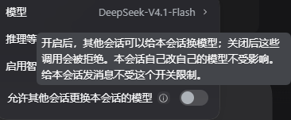
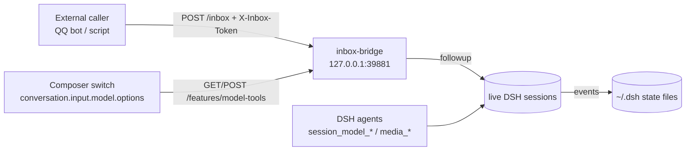

# dsh-session-bridge

[](./LICENSE)
[](https://github.com/deepseek-ai/deepseek-harness)

English | [简体中文](./README.zh.md)

<p align="center">
  
</p>

## Screenshots

**Consent switch** — when on, other sessions may switch this one's model; when off, those calls are
rejected. A session can always switch its own model, and messages are not gated by this switch.

_Still to come: a generation result at `assets/generation.png` (see [`assets/README.md`](./assets/README.md))._

Local session bridge for [DeepSeek Harness](https://github.com/deepseek-ai/deepseek-harness) (DSH):
a **local HTTP inbox** that delivers text into live sessions, **cross-session model switching and
messaging** gated by a per-session consent switch, and **image / video / audio generation** routed to
nine provider backends.

One package, three loader rows, one composer switch. Everything runs on `127.0.0.1`; no cloud relay,
no external account.

## Features

### Inbox (`inbox-bridge`)

- `POST /inbox` delivers text into any live session as a user message (`followup`), with `sessionId`
  or "the only live session" as the target.
- `dedupeKey` deduplicates redeliveries; `/delivery/{id}` reports the outcome.
- Busy-session policies: `wait` (bounded wait), `drop`, or queue until idle.
- Persisted journal: accepted-but-undelivered messages are replayed after a restart.
- Bearer-style auth via the `X-Inbox-Token` header; `Host`/`Origin` are validated as loopback only.

### Cross-session model switching (`session-model`)

- List live sessions with their current and last-used model, plus whether they are *allowed to be
  switched*.
- Switch another session's model — **target-side consent**: only when that session turned on
  "Allow other sessions to change this one" in its model menu. Switching your own model is always
  allowed.
- Send a message to another session; `hint` appends a short "this session has tool X" note so the
  receiver knows what it can use without switching models.
- Generation models are refused unless `allowNonChat: true` is passed.

### Generation tools (`media`)

- `media_models` discovers multimodal models from `ctx.llm` and marks which providers can actually
  generate.
- `image_generate`, `video_generate`, `audio_generate` route `provider/model` to the provider's native
  API; `extra` is merged into the request body (into `input` for Replicate).
- Nine backends: `dashscope`, `openai`, `ark`, `zhipu`, `fal`, `stability`, `elevenlabs`, `google`,
  `replicate`.
- HTTP proxy support per provider (`proxy`), via a CONNECT tunnel — Node's `fetch` ignores the system
  proxy.

## Architecture



| Row | Package entry | What it owns |
|---|---|---|
| `session-model` | package root (`.`) | Cross-session tools, and the client switch (a package-root row is required for the client half) |
| `inbox-bridge` | `./inbox` | HTTP inbox on `127.0.0.1:39881` |
| `media` | `./media` | Generation tools and the provider table |

State lives under `$DSH_HOME` (usually `~/.dsh`):

| File | Purpose |
|---|---|
| `inbox-bridge.json` | Port, token, default session |
| `session-bridge-features.json` | `{ "enabled": ["session-…"] }` — the per-session consent switch |
| `generated/` | Generated images, videos, audio |

## Install

Use the **Plugins** panel or `plugin_manager` in DSH:

```
# from GitHub
plugin_manager install_bundle("https://github.com/EHua-5/dsh-session-bridge")

# or from a local checkout
plugin_manager install_bundle("<absolute path to the checkout>")
```

The package declares a `dsh.bundle.patch`, so installation mounts all three rows. The `session-model`
row must be the **package root** — a subpath row does not get a client half, and the composer switch
would disappear.

Reload the affected rows after installing or editing. Client-side changes need a page refresh.

## Usage

### Inbox

```bash
TOKEN=$(python -c "import json,os;print(json.load(open(os.path.expanduser('~/.dsh/inbox-bridge.json')))['token'])")

curl -X POST http://127.0.0.1:39881/inbox \
  -H "X-Inbox-Token: $TOKEN" -H "Content-Type: application/json" \
  -d '{"text":"画一张雪地小猫","sessionId":"session-…","source":"bot","hint":"image_generate"}'
```

| Method | Path | Purpose |
|---|---|---|
| `GET` | `/health` | Version, queue counters, feature count |
| `GET` | `/sessions` | Live sessions (token required) |
| `POST` | `/inbox` | Deliver text; `dedupeKey`, `onBusy` (`wait`/`drop`/`queue`), `maxWaitMs` |
| `GET` | `/delivery/{id}` | Delivery outcome |
| `POST` | `/config` | Change default session / port |
| `GET`/`POST` | `/features/model-tools` | Read/write a session's consent switch (loopback page only) |

### Tools

| Tool | Purpose |
|---|---|
| `session_model_list` | Sessions, busy state, current/last model, consent |
| `session_model_catalog` | Provider models with context, reasoning effort, modalities, `kind` |
| `session_model_set` | Switch a session's model (consent-gated; `allowNonChat` for generation models) |
| `session_message_send` | Message another session; `hint` appends a tool hint |
| `media_models` | Discover generation-capable models |
| `image_generate` / `video_generate` / `audio_generate` | Generate media; `provider/model`, `extra` |

## Configuration

In the profile patch (`cordis.patch.yml`), each row takes a config:

```yaml
- insert:
    - id: inbox-bridge
      name: '@local/dsh-session-bridge/inbox'
      config:
        port: 39881
    - id: media
      name: '@local/dsh-session-bridge/media'
      config:
        outputDir: ~/.dsh/generated
        providers:
          dashscope:
            kind: dashscope
            host: https://token-plan.cn-beijing.maas.aliyuncs.com
            apiKeyEnv: BAILIAN_TPP_API_KEY
          openai:
            kind: openai
            host: https://api.openai.com
            apiKeyEnv: OPENAI_API_KEY
          google:
            kind: google
            host: https://generativelanguage.googleapis.com
            apiKeyEnv: GOOGLE_API_KEY
            proxy: http://127.0.0.1:7890
```

API keys are resolved in this order: `apiKey` → `apiKeyEnv` → `$DSH_HOME/.env` → the DSH credential
store. `media.config.providers` is keyed by the llm provider id, so `model: "bailian-tpp/wan2.7-image"`
picks that entry.

## Security model

- The HTTP server binds `127.0.0.1` only.
- Every message/config endpoint requires `X-Inbox-Token` (a random 32-hex token generated on first run).
- `/features/model-tools` is token-less on purpose: the GUI runs on another loopback port and cannot
  read the token. It only flips a boolean; the server rejects non-loopback `Host` (DNS rebinding) and
  non-loopback `Origin`, and reflects loopback origins only.
- The consent switch protects the **direct** path (cross-session model switching). It is not a defense
  against prompt injection: a message injected into a session can still ask that session to do things.
- Messages are stored in plain text in `~/.dsh/inbox-queue.jsonl` and logs; keep that in mind for
  sensitive content.

## Development

Plain ESM JavaScript, no build step.

```bash
node --test test/inbox.test.js test/model.test.js test/media.test.js   # 88 tests
```

On a machine without a standalone Node, use DSH's Electron as Node:

```bash
ELECTRON_RUN_AS_NODE=1 "D:/DSH/DeepSeek Harness.exe" test/media.test.js
```

| Path | Role |
|---|---|
| `inbox.js` | HTTP server, journal, queue, dedupe, delivery |
| `model.js` | Cross-session tools, consent checks, client row |
| `media.js` | Provider table, nine adapters, proxy tunnel |
| `shared.js` | Feature store and message delivery helpers |
| `client.js` | Browser half: the composer switch |
| `test/` | inbox / model / media suites |

## Limitations

- The client switch hard-codes the bridge port `39881`; change `client.js` if you change it.
- The `zhipu`, `fal`, `stability`, `elevenlabs`, `google`, `replicate` adapters are written against
  official docs but not verified with live accounts; expect small field fixes on first use.
- Google needs an HTTP proxy (set `proxy`) and a paid image quota.
- Video generation polls up to 6–8 minutes; longer jobs time out.
- Client-side changes require a page refresh; HMR does not reliably re-mount the switch.
- `/features` is a UX guardrail, not an injection boundary (see Security model).

## License

MIT
