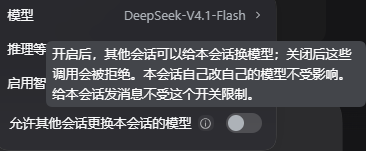

# dsh-session-bridge（会话桥）

[](./LICENSE)
[](https://github.com/deepseek-ai/deepseek-harness)

[English](./README.md) | 简体中文

<!-- 截图就位后取消注释：
<p align="center">
  
</p>
-->

## Screenshots

_待补：模型菜单里的同意开关、一次生成结果。文件命名与位置见 [`assets/README.md`](./assets/README.md)。_

本地运行的 [DeepSeek Harness](https://github.com/deepseek-ai/deepseek-harness)（DSH）会话桥：
**本地 HTTP 收件箱**把文字投进活会话、**按"目标同意"的跨会话换模型/发消息**、
**图片 / 视频 / 音频生成**（九种 provider 后端）。

一个包、三条插件行、一个输入框开关。全部只绑 `127.0.0.1`，不经过云中转，不需要外部账号。

## 功能

### 收件箱（`inbox-bridge`）

- `POST /inbox` 把文字作为用户消息投进指定会话（`followup`），可以指定 `sessionId` 或"唯一的活会话"
- `dedupeKey` 去重；`/delivery/{id}` 查投递结果
- 会话忙时的策略：`wait`（有界等待）/ `drop` / 排队到空闲
- 持久化日志：已接收未投递的消息在重启后补投
- `X-Inbox-Token` 头鉴权；`Host`/`Origin` 只允许回环

### 跨会话换模型（`session-model`）

- 列出活会话、当前模型、上次实际使用的模型，以及**是否允许被换**
- 给别的会话换模型——**被换方同意**：只有对方在模型菜单里打开「允许其他会话更换本会话的模型」才允许；
  自己改自己的模型不受限
- 给别的会话发消息；`hint` 会在消息末尾附一句"本会话可用某工具"，避免对方不知道该用什么
- 生成类模型默认拒绝，需显式 `allowNonChat: true`

### 生成工具（`media`）

- `media_models` 从 `ctx.llm` 发现多模态模型，标出哪些 provider 真能生成
- `image_generate` / `video_generate` / `audio_generate` 按 `provider/model` 走厂商原生接口；
  `extra` 原样并入请求体（replicate 并入 `input`）
- 九种后端：`dashscope`、`openai`、`ark`、`zhipu`、`fal`、`stability`、`elevenlabs`、`google`、`replicate`
- 支持按 provider 配 HTTP 代理（`proxy`），用 CONNECT 隧道——Node 的 `fetch` 默认不走系统代理

## 结构

| 插件行 | 包入口 | 负责 |
|---|---|---|
| `session-model` | 包根（`.`） | 跨会话工具 + 客户端开关（客户端半只从**包根行**发现） |
| `inbox-bridge` | `./inbox` | `127.0.0.1:39881` 的 HTTP 收件箱 |
| `media` | `./media` | 生成工具与 provider 表 |

状态文件在 `$DSH_HOME`（通常是 `~/.dsh`）：

| 文件 | 用途 |
|---|---|
| `inbox-bridge.json` | 端口、token、默认会话 |
| `session-bridge-features.json` | `{ "enabled": ["session-…"] }`，按会话的同意开关 |
| `generated/` | 生成产物 |

## 安装

用 DSH 的 **Plugins** 面板或 `plugin_manager`：

```
# 从 GitHub
plugin_manager install_bundle("https://github.com/EHua-5/dsh-session-bridge")

# 或本地目录
plugin_manager install_bundle("<仓库绝对路径>")
```

包声明了 `dsh.bundle.patch`，安装会挂上三条行。`session-model` 行必须指向**包根**——
子路径行拿不到客户端半，输入框开关会消失。

装完重载对应行；客户端改动需要刷新页面。

## 使用

### 收件箱

```bash
TOKEN=$(python -c "import json,os;print(json.load(open(os.path.expanduser('~/.dsh/inbox-bridge.json')))['token'])")

curl -X POST http://127.0.0.1:39881/inbox \
  -H "X-Inbox-Token: $TOKEN" -H "Content-Type: application/json" \
  -d '{"text":"画一张雪地小猫","sessionId":"session-…","source":"bot","hint":"image_generate"}'
```

| 方法 | 路径 | 用途 |
|---|---|---|
| `GET` | `/health` | 版本、队列计数、开关数 |
| `GET` | `/sessions` | 活会话（要 token） |
| `POST` | `/inbox` | 投递文字；`dedupeKey`、`onBusy`（`wait`/`drop`/`queue`）、`maxWaitMs` |
| `GET` | `/delivery/{id}` | 投递结果 |
| `POST` | `/config` | 改默认会话 / 端口 |
| `GET`/`POST` | `/features/model-tools` | 读/写某会话的同意开关（只允许回环页面） |

### 工具

| 工具 | 作用 |
|---|---|
| `session_model_list` | 会话、忙碌状态、当前/上次模型、能否被换 |
| `session_model_catalog` | 模型目录：上下文、推理强度、输入模态、`kind` |
| `session_model_set` | 换模型（目标同意；生成类模型需 `allowNonChat`） |
| `session_message_send` | 给别的会话发消息；`hint` 附工具提示 |
| `media_models` | 发现可生成的模型 |
| `image_generate` / `video_generate` / `audio_generate` | 生成；`provider/model`、`extra` |

## 配置

profile 的 `cordis.patch.yml` 里每行可以带 config：

```yaml
- insert:
    - id: inbox-bridge
      name: '@local/dsh-session-bridge/inbox'
      config:
        port: 39881
    - id: media
      name: '@local/dsh-session-bridge/media'
      config:
        outputDir: ~/.dsh/generated
        providers:
          dashscope:
            kind: dashscope
            host: https://token-plan.cn-beijing.maas.aliyuncs.com
            apiKeyEnv: BAILIAN_TPP_API_KEY
          openai:
            kind: openai
            host: https://api.openai.com
            apiKeyEnv: OPENAI_API_KEY
          google:
            kind: google
            host: https://generativelanguage.googleapis.com
            apiKeyEnv: GOOGLE_API_KEY
            proxy: http://127.0.0.1:7890
```

key 解析顺序：`apiKey` → `apiKeyEnv` → `$DSH_HOME/.env` → DSH 凭据库。`providers` 的键是 llm provider id，
所以 `model: "bailian-tpp/wan2.7-image"` 会用那条配置。

## 安全模型

- HTTP 只绑 `127.0.0.1`
- 消息/配置端点都要 `X-Inbox-Token`（首次运行随机生成 32 位 hex）
- `/features/model-tools` 故意免 token：GUI 在另一个回环端口，读不到 token。它只翻转一个布尔值；
  服务端拒绝非回环 `Host`（防 DNS rebinding）和非回环 `Origin`，并只反射回环 Origin
- 开关保护的是**直接路径**（跨会话换模型），不是提示注入的边界：被注入的会话仍可能被指示做事
- 消息明文存在 `~/.dsh/inbox-queue.jsonl` 和日志里，敏感内容注意

## 开发

纯 ESM JavaScript，无构建步骤。

```bash
node --test test/inbox.test.js test/model.test.js test/media.test.js   # 88 条
```

没有独立 Node 时用 DSH 自带的 Electron：

```bash
ELECTRON_RUN_AS_NODE=1 "D:/DSH/DeepSeek Harness.exe" test/media.test.js
```

| 文件 | 作用 |
|---|---|
| `inbox.js` | HTTP 服务、日志、队列、去重、投递 |
| `model.js` | 跨会话工具、同意校验、客户端行 |
| `media.js` | provider 表、九种适配器、代理隧道 |
| `shared.js` | 开关存储与消息投递 |
| `client.js` | 浏览器半：输入框开关 |

## 限制

- 客户端开关写死桥端口 `39881`，改端口要同步改 `client.js`
- `zhipu` / `fal` / `stability` / `elevenlabs` / `google` / `replicate` 是按官方文档写的，没做真机验证，
  首次使用可能要修小字段
- Google 需要 HTTP 代理（配 `proxy`）且有付费图片额度
- 视频轮询上限 6–8 分钟，更长的任务会超时
- 客户端改动要刷新页面，HMR 不能可靠重挂开关
- `/features` 只是 UX 护栏，不是注入边界（见安全模型）

## 许可

MIT
